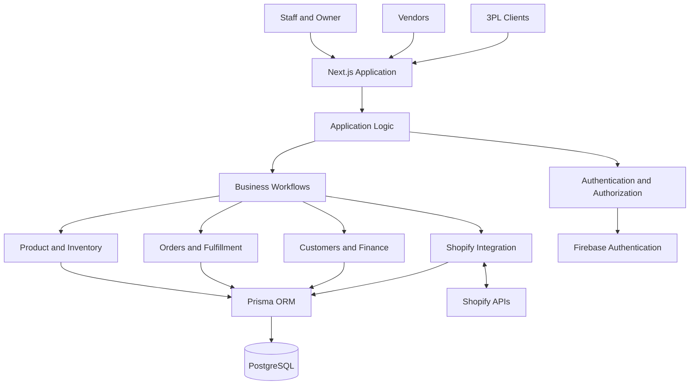

# V3PL — Multi-Vendor Inventory & 3PL Fulfillment Platform

**A centralized operations platform for multi-vendor inventory, warehouse management, third-party logistics (3PL), order fulfillment, financial tracking, and Shopify-connected commerce.**

[](https://github.com/mdyusuf166/v3pl-platform)
[](https://nextjs.org/)
[](https://www.typescriptlang.org/)
[](https://www.postgresql.org/)
[](https://www.prisma.io/)
[](https://firebase.google.com/)
[](LICENSE)

---

## Table of Contents

- [Overview](#overview)
- [The Problem](#the-problem)
- [Key Capabilities](#key-capabilities)
- [User Portals and Access](#user-portals-and-access)
- [System Architecture](#system-architecture)
- [Technology Stack](#technology-stack)
- [Core Business Workflows](#core-business-workflows)
- [Repository Structure](#repository-structure)
- [Getting Started](#getting-started)
- [Environment Configuration](#environment-configuration)
- [Database and Prisma](#database-and-prisma)
- [Shopify Integration](#shopify-integration)
- [Security Considerations](#security-considerations)
- [Testing and Verification](#testing-and-verification)
- [Production Readiness](#production-readiness)
- [Roadmap](#roadmap)
- [Documentation](#documentation)
- [Contributing](#contributing)
- [License](#license)
- [Author](#author)

## Overview

V3PL is a web-based operations platform designed to bring multi-vendor commerce, inventory management, warehouse operations, and third-party logistics into a centralized system.

The platform addresses the operational complexity of managing products, inventory, orders, fulfillment activities, customers, financial records, and external commerce integrations across a shared application.

Built with Next.js and TypeScript, backed by PostgreSQL and Prisma, and using Firebase Authentication, V3PL provides the foundation for coordinated workflows between internal staff, platform owners, vendors, and third-party logistics clients.

The application includes dedicated staff and owner operations alongside user-facing functionality for vendors and 3PL clients.

**Repository:** [github.com/mdyusuf166/v3pl-platform](https://github.com/mdyusuf166/v3pl-platform)

## The Problem

Multi-vendor commerce and fulfillment operations often involve disconnected systems for:

- Product catalogs and vendor management.
- Inventory quantities and stock movements.
- Warehouse operations and fulfillment.
- Customer and order management.
- Financial charges and operational accounting.
- External commerce platforms and synchronization.

When these systems are disconnected, teams can struggle with inconsistent data, manual reconciliation, limited operational visibility, and unreliable workflows.

V3PL aims to centralize these operational responsibilities in one platform, providing a shared application foundation for inventory, fulfillment, finance, and commerce integration.

## Key Capabilities

The following areas describe the platform's documented scope. Individual features and their current implementation status should be verified against the codebase and the project's progress documentation.

### Inventory and Product Management

- Product catalog management.
- Multi-vendor inventory workflows.
- Inventory visibility and operational tracking.
- Stock-related data management.
- Integration between product and order operations.

### Warehouse and 3PL Operations

- Warehouse-oriented operational workflows.
- Third-party logistics client support.
- Order fulfillment management.
- Coordination of inventory and fulfillment activities.
- Operational interfaces for internal staff and external users.

### Order Management

- Order processing and management.
- Order fulfillment workflows.
- Customer and order record management.
- Coordination between orders, products, and inventory.

### Financial Operations

- Financial record management.
- Charge tracking.
- Finance-related operational workflows.
- Ledger-oriented financial data management.

Financial records and charge tracking should not be interpreted as a guarantee of complete accounting, payment processing, or financial compliance.

### Shopify Integration

- Shopify-connected commerce workflows.
- Synchronization-related functionality.
- Integration between external store data and platform operations.

Production credentials, live-store behavior, synchronization reliability, webhook handling, and deployment-specific configuration must be validated independently.

### Administrative Operations

- Internal staff and owner interfaces.
- Role-based access functionality.
- Centralized management of platform operations.
- User-facing access for vendors and 3PL clients.

## User Portals and Access

V3PL documents separate application areas for internal administration and external users.

| Portal | Route | Intended audience |
|---|---|---|
| Administration | `/admin` | Internal staff and administrative operations |
| User portal | `/user` | Vendors and 3PL clients |

These routes describe the intended application structure. Actual access restrictions must be enforced by the application's server-side authorization logic, not merely by hiding navigation links or checking the current page.

The precise permissions associated with each role depend on the implemented authorization rules.

## System Architecture

V3PL uses a Next.js and TypeScript application architecture with PostgreSQL persistence, Prisma data access, and Firebase Authentication.



The diagram represents the platform's logical architecture, not a verified deployment topology or a complete map of its runtime dependencies.

### Architectural Responsibilities

**Next.js and TypeScript**

Provide the web application framework and typed application code.

**Application and business logic**

Coordinate product, inventory, order, fulfillment, customer, finance, and integration workflows.

**Firebase Authentication**

Provides the authentication infrastructure. Authentication establishes identity; the application must separately enforce permissions for protected resources.

**Prisma ORM**

Provides the application’s database access and schema-management layer.

**PostgreSQL**

Stores persistent relational application data.

**Shopify integration**

Connects the platform with external commerce data and workflows, subject to the configured integration and synchronization mechanisms.

## Technology Stack

| Technology | Responsibility |
|---|---|
| Next.js | Web application framework |
| TypeScript | Application language and static typing |
| PostgreSQL | Relational database |
| Prisma | ORM and database schema management |
| Firebase Authentication | User authentication |
| Shopify APIs | External commerce integration |

This list identifies the documented core stack. Additional dependencies, deployment services, testing frameworks, and infrastructure tools should be confirmed from the project's package manifest and configuration files.

## Core Business Workflows

### 1. Product and Inventory Management

1. Authorized users access product and inventory functionality.
2. Product and stock-related information is managed through the application.
3. Inventory information supports operational workflows.
4. Order and fulfillment processes use the relevant product and inventory data.

**Important:** Stock reservation, concurrent updates, inventory ledger integrity, and reconciliation behavior must be verified against the actual implementation.

### 2. Order Fulfillment

1. Orders are managed through the platform.
2. Relevant product, customer, and inventory records support processing.
3. Fulfillment activities are coordinated through the available operational workflows.
4. Resulting records provide visibility into order operations.

The exact order lifecycle, state transitions, cancellation behavior, and exception handling depend on the implemented business rules.

### 3. Vendor and 3PL Operations

1. Vendors and 3PL clients access their intended user-facing application area.
2. The platform exposes functionality according to implemented permissions.
3. Shared operational workflows connect inventory, orders, and fulfillment.
4. Authorized staff can perform administrative activities.

Tenant isolation and object-level authorization must be verified to ensure that one vendor or client cannot access another party's protected data.

### 4. Financial Tracking

1. Operational financial records and charges are managed through available finance workflows.
2. Related records support financial visibility and reconciliation.
3. Authorized users access finance-related functionality according to the application's permissions.

The existence of finance features does not by itself establish double-entry accounting, immutable audit trails, or compliance with a particular accounting standard.

### 5. Shopify Synchronization

1. A Shopify integration is configured using the required credentials and settings.
2. The application communicates with the relevant Shopify APIs.
3. Supported synchronization workflows exchange or update commerce data.
4. Integration errors and data consistency must be monitored and verified.

Live synchronization should not be considered production-ready until authentication, API permissions, webhook behavior where applicable, retries, duplicate-event handling, rate limits, and recovery procedures have been tested.

## Repository Structure

The repository contains the application project and supporting documentation.

```text
v3pl-platform/
├── README.md
└── v3pl-main/
    ├── README.md
    ├── package.json
    └── docs/
        ├── progress.md
        ├── DECISIONS.md
        ├── architecture.md
        ├── runbook.md
        ├── shopify-integration.md
        └── roadmap.md
```

This is a documentation-oriented overview, not a complete source-tree listing. Additional application directories, Prisma schema files, scripts, tests, and configuration files may exist within `v3pl-main/`.

## Getting Started

### Prerequisites

Before running V3PL locally, ensure that you have:

- A supported Node.js version compatible with the project.
- npm or the package manager specified by the repository.
- Access to a PostgreSQL database.
- Firebase project configuration for authentication.
- Shopify development-store credentials if you intend to test Shopify functionality.
- Git installed on your machine.

Check the project's package manifest and documentation for exact version requirements.

### 1. Clone the Repository

```bash
git clone https://github.com/mdyusuf166/v3pl-platform.git
cd v3pl-platform
```

### 2. Enter the Application Directory

```bash
cd v3pl-main
```

### 3. Install Dependencies

If the project uses npm:

```bash
npm install
```

For reproducible installations, use the repository's committed lockfile and prefer `npm ci` when the environment and lockfile are compatible.

### 4. Configure Environment Variables

Inspect the example environment file:

```bash
# Linux or macOS
cat .env.example
```

On Windows PowerShell:

```powershell
Get-Content .env.example
```

Create the local environment file using the filename and variables expected by the project. A common convention is `.env.local`, but follow the application's actual configuration.

Populate the required database, Firebase, and optional Shopify settings using valid development credentials.

Never commit real secrets.

### 5. Prepare the Database

Review the Prisma schema and the documented database setup procedure before applying changes.

If the project uses Prisma and the corresponding scripts are configured, schema generation may be performed with:

```bash
npx prisma generate
```

For a development database, apply migrations using the repository's documented migration workflow. For example, `npx prisma migrate dev` is appropriate only when the project uses Prisma Migrate and the database is intended for development.

Do not run development migration commands against production.

### 6. Start the Development Server

If the package manifest defines the standard Next.js development script:

```bash
npm run dev
```

Open the local address printed by the development server, commonly:

```text
http://localhost:3000
```

The actual port may differ if the default port is unavailable or the project configures another port.

### 7. Verify the Application

After startup:

- Confirm that the application loads.
- Test sign-in with an authorized development account.
- Verify the appropriate portal routes.
- Check database connectivity.
- Test representative product, inventory, and order workflows.
- Validate role restrictions with separate test accounts.
- Test Shopify functionality only against an appropriately configured development store.

**Setup note:** The commands above follow standard Next.js and Prisma conventions where applicable. Confirm script names, environment variables, migration procedures, and supported runtime versions against the current repository before treating this section as a fully verified installation guide.

## Environment Configuration

V3PL relies on environment-specific configuration. The exact variable names must be obtained from `.env.example`, application configuration, and the integration documentation.

| Configuration area | Purpose |
|---|---|
| Database connection | PostgreSQL connectivity |
| Firebase client configuration | Client-side authentication setup |
| Firebase server-side credentials, if required | Trusted server-side identity verification |
| Shopify application settings | Store connectivity and API access |
| Application URL and runtime settings | Environment-specific application behavior |

### Environment Security

- Keep local environment files out of version control.
- Never publish private keys, database passwords, access tokens, or service-account credentials.
- Use separate credentials for development, staging, and production.
- Restrict database and integration credentials to the minimum required permissions.
- Rotate credentials immediately if they are exposed.
- Validate environment variables during startup where appropriate.

Do not assume that every listed configuration area requires a separate environment variable; use the names and requirements defined by the implementation.

## Database and Prisma

PostgreSQL provides relational persistence, while Prisma provides the application's database access and schema-management interface.

Database changes should follow a controlled migration workflow.

Recommended engineering practices include:

- Review schema changes before deployment.
- Use version-controlled migrations where configured.
- Test migrations against a representative non-production database.
- Back up production data before risky schema changes.
- Define appropriate indexes and database constraints.
- Use transactions for operations that require atomic updates.
- Test concurrent inventory changes and order processing.
- Establish backup restoration and recovery procedures.

The actual schema, relations, constraints, and transaction boundaries should be reviewed before making assumptions about data integrity.

## Shopify Integration

Shopify connectivity is an important component of V3PL's commerce operations.

The project includes Shopify integration functionality, while some production configuration and verification remain subject to the current project status.

### Integration Responsibilities

A reliable integration may need to address:

- Shopify application authentication and scopes.
- Store and connection configuration.
- Product and inventory synchronization.
- Order-related synchronization where implemented.
- Webhook verification and event processing where applicable.
- API rate limits and transient failures.
- Idempotency and duplicate-event handling.
- Logging, monitoring, and recovery.

These items are engineering requirements to validate, not a claim that every mechanism has already been implemented.

### Before Connecting a Production Store

1. Review `docs/shopify-integration.md`.
2. Confirm the required API permissions.
3. Validate the configured credentials and environment variables.
4. Test against a development store.
5. Verify synchronization direction and conflict-resolution behavior.
6. Test failure recovery and duplicate-event scenarios.
7. Confirm operational monitoring and credential rotation procedures.

Do not connect a live store until the applicable integration and security checks have passed.

## Security Considerations

V3PL handles operational, customer, inventory, and financial information. Security must therefore be treated as a core engineering requirement.

### Authentication and Authorization

- Authenticate users before granting access to protected resources.
- Enforce permissions on the server side.
- Validate roles and resource ownership for every sensitive operation.
- Prevent cross-vendor and cross-client data access.
- Do not rely exclusively on client-side route protection.

### Data Protection

- Use HTTPS in deployed environments.
- Store credentials in a managed secrets system or secure deployment environment.
- Validate and sanitize untrusted inputs.
- Apply appropriate database access controls.
- Avoid logging tokens, passwords, or sensitive customer information.

### Operational Security

- Review dependencies and security advisories.
- Monitor authentication failures and privileged operations.
- Protect administrative endpoints.
- Establish backup, recovery, and incident-response procedures.
- Test authorization boundaries with accounts representing different roles.

These are recommended controls. Their actual implementation and effectiveness require code review and testing.

## Testing and Verification

A successful development-server startup is not sufficient to establish application correctness or production readiness.

A comprehensive verification process should cover:

| Area | What to verify |
|---|---|
| Application startup | Build, startup, and runtime behavior |
| Authentication | Sign-in, sign-out, and session handling |
| Authorization | Role restrictions and resource ownership |
| Inventory | Stock consistency and concurrent updates |
| Orders | Valid state transitions and fulfillment behavior |
| Finance | Charge accuracy and reconciliation |
| Database | Schema consistency and migration safety |
| Shopify | Authentication, synchronization, and recovery |
| Security | Input validation, secrets handling, and access control |
| Operations | Logging, backups, and incident recovery |

### Run Project Checks

Inspect the available scripts first:

```bash
npm run
```

Then execute the project's configured scripts, using their actual names. For example, if defined in `package.json`:

```bash
npm run lint
npm run typecheck
npm test
npm run build
```

These are conditional examples; a script that is not defined by the project will not run successfully. Use the repository's documented alternatives where necessary.

Record verification results, failures, and known limitations in the project's progress documentation.

## Production Readiness

V3PL's documented feature development and its production readiness are separate concerns.

Before a production release, verify the following:

- [ ] A clean installation succeeds using documented instructions.
- [ ] Required environment variables are documented and validated.
- [ ] Database migrations are reproducible and reviewed.
- [ ] Authentication and server-side authorization have been tested.
- [ ] Vendor and 3PL tenant isolation has been verified.
- [ ] Inventory and order consistency have been tested under concurrency.
- [ ] Financial calculations and reconciliation have been validated.
- [ ] Shopify production configuration has been verified.
- [ ] Integration retries and failure recovery have been tested where applicable.
- [ ] Automated checks and relevant integration tests pass.
- [ ] Secrets are managed securely.
- [ ] Logging and monitoring are configured.
- [ ] Backups and restoration have been tested.
- [ ] Deployment and rollback procedures are documented.

This checklist describes release criteria; it does not imply that all items are currently complete.

## Roadmap

The project's detailed status and planned work should be maintained in [`docs/progress.md`](v3pl-main/docs/progress.md) and [`docs/roadmap.md`](v3pl-main/docs/roadmap.md).

The following areas are useful priorities for continued development:

### Reliability

- Strengthen automated coverage for critical business workflows.
- Validate data consistency across inventory, orders, and fulfillment.
- Improve recovery behavior for failed operations.

### Integration Quality

- Complete outstanding Shopify production setup and verification.
- Validate synchronization behavior against real integration scenarios.
- Improve integration observability and error recovery where needed.

### Reporting and Data Workflows

- Complete pending reporting work.
- Validate import workflows, including malformed input and duplicate records.
- Document data validation and reconciliation behavior.

### Production Operations

- Establish repeatable deployment procedures.
- Verify monitoring, backup restoration, and rollback.
- Complete security and access-control reviews.

**Source of truth:** Update this roadmap based on the latest progress notes and verified implementation. Do not mark a task complete solely because a related interface or partial workflow exists.

## Documentation

Use the following project documents for implementation-specific details:

| Document | Purpose |
|---|---|
| [`README.md`](v3pl-main/README.md) | Application-specific overview and setup |
| [`docs/progress.md`](v3pl-main/docs/progress.md) | Implementation status and outstanding work |
| [`docs/DECISIONS.md`](v3pl-main/docs/DECISIONS.md) | Project decisions |
| [`docs/architecture.md`](v3pl-main/docs/architecture.md) | Architecture documentation |
| [`docs/runbook.md`](v3pl-main/docs/runbook.md) | Operational procedures |
| [`docs/shopify-integration.md`](v3pl-main/docs/shopify-integration.md) | Shopify integration guidance |
| [`docs/roadmap.md`](v3pl-main/docs/roadmap.md) | Planned development work |

These relative links assume that this README is located at the repository root and that the documented paths remain unchanged.

## Contributing

Contributions that improve reliability, maintainability, security, documentation, and operational correctness are valuable.

### Suggested Contribution Workflow

1. Review the existing architecture and project decisions.
2. Identify the relevant workflow and its current implementation status.
3. Create a focused branch for your change.
4. Keep changes aligned with existing conventions.
5. Add or update tests for changed behavior.
6. Run the relevant available checks.
7. Document configuration changes and operational implications.
8. Submit a pull request with a clear explanation of the change and verification results.

For changes affecting inventory, order state, finance, authorization, or Shopify synchronization, include particular attention to data consistency, failure handling, and backward compatibility.

## License

A license has not been specified in this README.

Before distributing the project or accepting external contributions, add the appropriate `LICENSE` file and document the project's usage and contribution terms.

## Author

**M. D. Yousuf**

- **GitHub:** [@mdyusuf166](https://github.com/mdyusuf166)
- **Repository:** [v3pl-platform](https://github.com/mdyusuf166/v3pl-platform)

---

V3PL brings together the core operational concerns of multi-vendor commerce and third-party logistics in one application: inventory, orders, fulfillment, finance, and commerce integration.

The long-term engineering objective is a reliable, secure, maintainable platform whose business workflows are supported by verified data integrity, clear access boundaries, automated testing, and production-ready operational practices.
